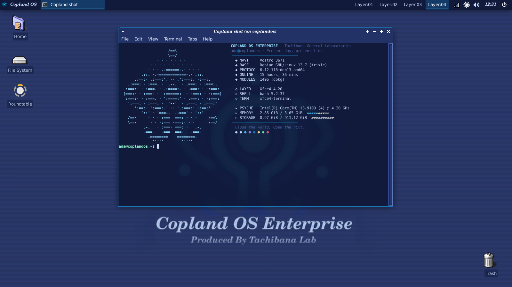

# Copland OS Enterprise for Debian XFCE

A Serial Experiments Lain desktop for Debian XFCE: the Copland OS look from the
show, with one installer that sets up the whole thing, not just config files.



## Install

One line, from a terminal inside your XFCE session, as your own user:

```bash
curl -fsSL https://raw.githubusercontent.com/anas1412/copland-os-dotfiles/main/install.sh | bash
```

It downloads the dotfiles to `~/.local/share/copland-os/src/` and opens the menu:
arrow keys to move, space to toggle a component, enter to install. Nothing is
changed before you confirm.

Pass options after `bash -s --`, for example a dry run:

```bash
curl -fsSL https://raw.githubusercontent.com/anas1412/copland-os-dotfiles/main/install.sh | bash -s -- --dry-run
```

Or from a clone:

```bash
git clone https://github.com/anas1412/copland-os-dotfiles.git
cd copland-os-dotfiles
./install.sh
```

| Option | What it does |
|---|---|
| *(none)* | interactive menu |
| `--yes` | install the default selection without asking |
| `--dry-run` | print every command, change nothing |
| `--only theme,icons` | install only the listed components |
| `--list` | list component ids |
| `--restore` | put back the settings saved by the last run |

### Installing single components

Every component can be installed on its own. In the menu, press `n` to clear the
selection and space to pick only what you want. Or name them with `--only`:

```bash
curl -fsSL https://raw.githubusercontent.com/anas1412/copland-os-dotfiles/main/install.sh | bash -s -- --only cursors
curl -fsSL https://raw.githubusercontent.com/anas1412/copland-os-dotfiles/main/install.sh | bash -s -- --only theme,icons,wallpaper
```

`--list` prints the ids. Running a component again is safe: it backs up what it
replaces first.

To install a specific release instead of `main`, set `COPLAND_REF`, for
example `curl -fsSL .../install.sh | COPLAND_REF=v1.0 bash`.

## Components

| Id | Default | What you get |
|---|---|---|
| `packages` | on | installs the missing apt packages (sudo) |
| `theme` | on | CoplandOS GTK 2/3 theme, xfwm4 window borders, notification style, fonts (C059 for titles, Nimbus Sans for the interface) |
| `icons` | on | Mac OS 9 icons (NineIcons from Platinum9). The show's Copland OS is drawn from Apple's Copland and Mac OS 8/9 |
| `cursors` | on | classic Mac pixel-art cursors ([Retrosmart](https://github.com/useless-anvil/retrosmart-cursor), Mac-ish) |
| `wallpaper` | on | the Copland OS Enterprise boot frame |
| `panel` | on | top bar: Copland menu (with the Copland logo as its profile picture), window list, Layer:01–04, tray, clock, power. **Replaces your current panel layout** |
| `terminal` | on | xfce4-terminal palette and font, fastfetch config, `~/.bashrc` hook |
| `layers` | on | 4 workspaces named Layer:01–04, plus `copland-layers`, a small picker to choose which app opens on which layer. Nothing is assigned until you choose |
| `keys` | on | the Super (Windows) key opens the Copland menu; Super+1–4 (number row or numpad) jump to Layer:01–04; Super+Shift+1–4 send the focused window there |
| `greeter` | off | LightDM login screen in the same theme (sudo) |
| `boot` | off | Plymouth boot animation from a third-party repo (sudo, experimental) |

## Choosing your layers

The installer does not assume which apps you use. After installing `layers`, run
`copland-layers` (or open **Copland Layers** from the menu). It lists your
installed apps and open windows; move with the arrow keys and press `1`–`4` to
send an app to a layer, `0` to leave it wherever you are.

- `d` sets where every other app goes (default: anywhere).
- `f` sets whether opening an app switches you to its layer.
- `s` saves to `~/.config/copland-os/layers.conf` and applies at once.

## Safety

- Refuses to run as root; asks for sudo only for `packages`, `greeter` and `boot`.
- Checks that it is inside an XFCE session before it touches anything.
- Saves your XFCE settings, `~/.bashrc` and existing configs to
  `~/.local/share/copland-os/backups/<timestamp>/` first. An existing theme or
  icon folder is moved there, not deleted.
- Each component runs on its own with `set -e`; a failure is reported and the
  others still run. The full output is in `~/.local/share/copland-os/install-<timestamp>.log`.
- Packages that your release does not have are skipped and named, not fatal.

## Login screen and boot animation

Both are off by default and need sudo.

- **Login screen** copies the theme, icons and wallpaper to `/usr/share` because
  the greeter cannot read your home folder. That copy is a snapshot: after you
  change the theme or icons, run `./install.sh --only greeter` again.
- **Boot animation** clones a third-party Plymouth theme at a pinned commit (it
  has no licence file, so it is not bundled here), adds `splash` to the kernel
  command line and rebuilds the initramfs of every installed kernel. Its frames
  are 1336x768 and are centred, not scaled. If boot misbehaves, press `Esc` for
  the text log, or remove `splash` from the GRUB entry for one boot.
- Both keep a `.copland-bak` copy of the file they edit; `--restore` offers to
  put them back.

## What was tested

Tested on Debian 13 (trixie) with XFCE 4.20: the menu, `--dry-run`, and a real
run of `theme`, `icons`, `cursors`,
`wallpaper`, `panel`, `terminal`, `layers` and `keys`, and the `copland-layers`
picker (navigation and loading; window placement from its config file).

Not tested: `packages` on a system that is missing them, `greeter` and `boot` through this
installer (the same steps were run from an earlier standalone script; how the
login screen and boot animation look has not been checked), `--restore`, and any
release other than Debian 13.

## Layout

```
install.sh                  the installer
files/themes/CoplandOS/     GTK theme, xfwm4 borders, notification style, logo
files/backgrounds/          wallpaper
files/icons/NineIcons/      Mac OS 9 icon theme
files/cursors/              classic Mac cursor theme and its licence
files/fastfetch/            fastfetch config
docs/screenshot.png         the screenshot above
files/devilspie2/           per-app workspace rules (read layers.conf)
files/bin/copland-layers    the layer picker
files/bin/copland-goto      jump to a layer (Super+number)
files/bin/copland-send      send the focused window to a layer (Super+Shift+number)
```

## Credits

- GTK and xfwm4 theme: a recolour of [Greybird](https://github.com/shimmerproject/Greybird) (GPL-2.0-or-later / CC-BY-SA-3.0).
- Icons: NineIcons from [Platinum9](https://github.com/grassmunk/Platinum9) by grassmunk (bundled; that repository declares no licence), plus a power glyph of our own.
- Cursors: [Retrosmart Xcursor](https://github.com/useless-anvil/retrosmart-cursor) v2.0.3 by mdomlop and useless-anvil, GPL-3.0 (licence text in `files/cursors/`).
- Menu logo: "Copland Os Enterprise Icon" by PsyBear,
  <https://www.deviantart.com/psybear/art/Copland-Os-Enterprise-Icon-65838629>. Copyright PsyBear.
- Wallpaper: a frame from *Serial Experiments Lain*, via <https://lain.wiki/wiki/Copland_OS>.
  Copyright its owners; not covered by this repository's licence.
- fastfetch logo and installer banner: the built-in `LainOS` logo of [fastfetch](https://github.com/fastfetch-cli/fastfetch).
- Boot animation (optional): <https://github.com/faisalhsn/copland-plymouth-theme>.
