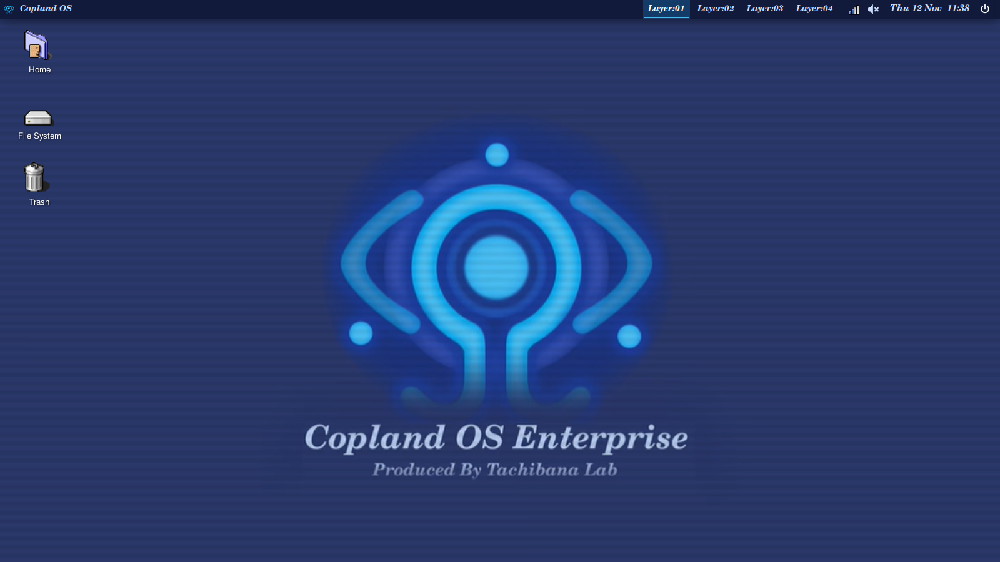
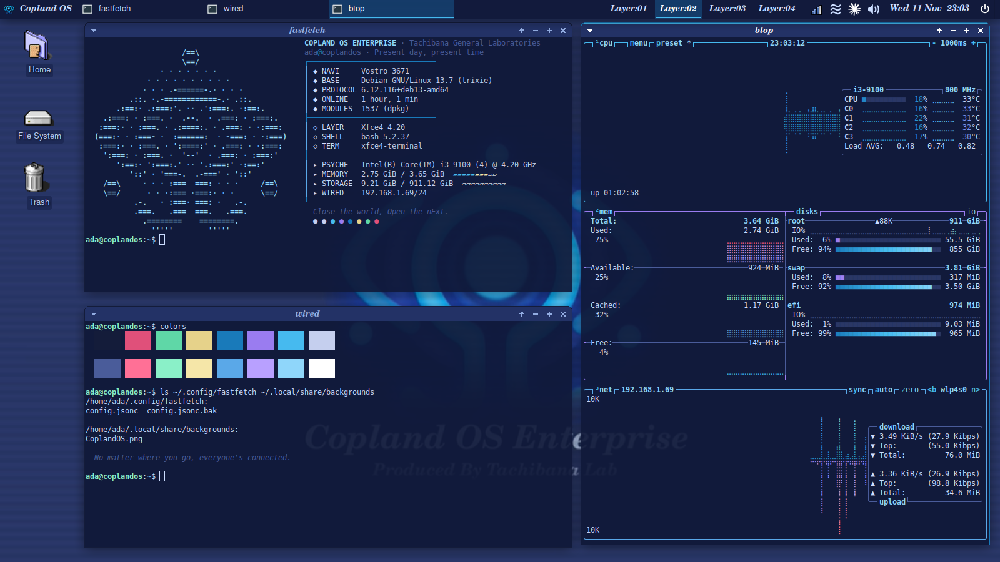

# Copland OS

A Serial Experiments Lain desktop OS built on upstream Debian 13 (trixie) and XFCE:
the Copland OS look from the show, as a whole system, not just a theme. Every package
but one comes from Debian's own servers; the one is the look itself,
`copland-os-desktop`, from Copland's own signed apt repository.

Website: <https://anas1412.github.io/copland-os/>

- **CoplandOS.iso** is the project: a live and installable image with everything
  built in (see below).
- **The installer** is optional, for people who already run Debian XFCE and want the
  look without reinstalling: one line for your own account, or `--system` for every
  account on the machine.





## CoplandOS.iso

The main way to get Copland OS: a live and installable image. Boot it from USB to try
it, then install it with the Copland-branded installer.

Download it from the [latest release](https://github.com/anas1412/copland-os/releases/latest),
or build it yourself (below); everything inside it is the same code the installer uses.

What is in it: Debian 13 with a lean XFCE desktop
(Firefox ESR, terminal, file manager, text editor, image and PDF viewers, no
LibreOffice: that and more are one tick away, see below), Copland OS installed as the `copland-os-desktop` package (the same
files as `--system`), and the Calamares installer branded as Copland OS. Installed
systems get Debian's updates and Copland's with the same `sudo apt update && sudo apt
upgrade` (or one click on the update icon in the top bar, which checks once a day): the image includes Copland's signed apt source next to Debian's. The image's own boot menu and the
installed system's boot menu both have the Copland look. The live user is `lain`
(password `live`, live-config's default) and the hostname `coplandos`.

### Extra apps and developer tools

The installer has two optional pages after Users, **Apps** and **Developer tools**.
Each is a checklist: click what you want. Nothing is ticked at first, so the plain
install stays small and works offline. Whatever you tick
is downloaded at the end of the install (it needs an internet connection; without one
the install still finishes, and a note in your home folder says what to run later).

| Apps | From | | Developer tools | From |
|---|---|---|---|---|
| Brave Origin (becomes the default browser) | Brave's repository | | Visual Studio Code | Microsoft's repository |
| LibreOffice (Writer, Calc, Impress) | Debian | | Python (pip, venv, pipx) | Debian |
| Thunderbird | Debian | | Node.js, current LTS | NodeSource's repository |
| GIMP | Debian | | Go, current release | Debian backports |
| VLC | Debian | | Rust (rustup, stable toolchain) | Debian's rustup |
| OBS Studio | Debian | | Java (OpenJDK 25) | Debian |
| KeePassXC | Debian | | C and C++ (gcc, make, cmake, gdb) | Debian |
| Flatpak and Flathub | Debian + Flathub | | Docker with Compose and Buildx | Docker's repository |
| | | | Podman with podman-compose | Debian |

Each item shows its maker's own icon and screenshot or logo (sources and terms in
`iso/branding/extras/CREDITS`). Languages come
from wherever their current, supported version is: Debian's own Node.js 20, Go 1.24 and
Docker 26 are past their makers' end of life, so those three come from newer sources.
An outside repository is added only when its item is ticked, and its signing key is
checked against the published fingerprint first.

Everything gets the Copland look where the app allows it: Brave by the same colour
policy as other Chromium browsers, VS Code with Copland colours, terminal palette and
the system's window frame, OBS with a Copland theme, GIMP with its System theme
(follows the desktop), LibreOffice through its GTK plugin, VLC and KeePassXC through
Qt's GTK theme. Your own settings are never overwritten.

Every item can be installed and checked for real in a clean Debian 13 container on
GitHub (`tests/test-extras.sh`, the **copland-extras** workflow, started by hand).

The same tool works on an installed system, any time:

```bash
sudo copland-extras --list
```

```bash
sudo copland-extras vscode node docker
```

### Building it

The easy way: GitHub Actions builds it for free (Actions tab, **CoplandOS.iso**, **Run
workflow**); the ISO is attached to the run. To build on your own Debian 13 machine:

```bash
sudo apt install live-build debootstrap wget git
sudo ./iso/build.sh            # -> iso/out/CoplandOS-<version>-deb13-amd64.iso and .sha256
./iso/build.sh --check         # only the checks, no root
```

The build needs root, about 20 GB free, a network connection, and the apt repository
published (the image's apt source points at it, so the build checks it first); it works in
`/var/tmp/coplandos-build` (set `COPLAND_ISO_WORK` to change it). Each image comes
with a build record (repo commit, tool versions, every package with its version,
the log). The whole method is in [docs/BUILDING.md](docs/BUILDING.md). So far the
configuration is checked (`lb config` accepts every option and every package is
in trixie); no image has been built or booted yet.

## Already on Debian XFCE? The installer (optional)

For people who already run Debian XFCE and want the look without reinstalling.

One line, from a terminal inside your XFCE session, as your own user:

```bash
curl -fsSL https://raw.githubusercontent.com/anas1412/copland-os/main/install.sh | bash
```

It downloads the repository to `~/.local/share/copland-os/src/` and opens the menu:
arrow keys to move, space to toggle a component, enter to install. Nothing is
changed before you confirm.

Pass options after `bash -s --`, for example a dry run:

```bash
curl -fsSL https://raw.githubusercontent.com/anas1412/copland-os/main/install.sh | bash -s -- --dry-run
```

Or from a clone:

```bash
git clone https://github.com/anas1412/copland-os.git
cd copland-os
./install.sh
```

| Option | What it does |
|---|---|
| *(none)* | interactive menu |
| `--yes` | install the default selection without asking |
| `--dry-run` | print every command, change nothing |
| `--only theme,icons` | install only the listed components |
| `--list` | list component ids |
| `--restore` | put back the settings saved by the last run |

### Installing single components

Every component can be installed on its own. In the menu, press `n` to clear the
selection and space to pick only what you want. Or name them with `--only`:

```bash
curl -fsSL https://raw.githubusercontent.com/anas1412/copland-os/main/install.sh | bash -s -- --only cursors
curl -fsSL https://raw.githubusercontent.com/anas1412/copland-os/main/install.sh | bash -s -- --only theme,icons,wallpaper
```

`--list` prints the ids. Running a component again is safe: it backs up what it
replaces first.

To install a specific release instead of `main`, set `COPLAND_REF`, for
example `curl -fsSL .../install.sh | COPLAND_REF=v1.0 bash`.

## Components

Every file and setting each component touches, and how to undo it: [docs/WHAT-CHANGES.md](docs/WHAT-CHANGES.md).

| Id | Default | What you get |
|---|---|---|
| `packages` | on | installs the missing apt packages (sudo) |
| `theme` | on | CoplandOS GTK 2/3 theme, xfwm4 window borders, notification style, fonts (C059 for titles, Nimbus Sans for the interface) |
| `icons` | on | Mac OS 9 icons (NineIcons from Platinum9). The show's Copland OS is drawn from Apple's Copland and Mac OS 8/9 |
| `cursors` | on | classic Mac pixel-art cursors ([Retrosmart](https://github.com/useless-anvil/retrosmart-cursor), Mac-ish) |
| `wallpaper` | on | the Copland OS Enterprise image (eye and wordmark) |
| `panel` | on | top bar: Copland menu (with the Copland logo as its profile picture), window list, Layer:01–04, tray, clock with date, power. **Replaces your current panel layout** |
| `terminal` | on | xfce4-terminal palette and font, fastfetch config, `~/.bashrc` hook, btop theme |
| `layers` | on | 4 workspaces named Layer:01–04 (an app asking for attention takes you to its layer) |
| `keys` | on | the Super (Windows) key opens the Copland menu; Super+1–4 (number row or numpad) jump to Layer:01–04; Super+Shift+1–4 send the focused window there |
| `browsers` | off | Copland colour for Chromium-family browsers (Brave, Chromium, Chrome, Edge) by managed policy; Firefox follows the GTK theme on its own. Also installs `copland-extras` (more apps, see CoplandOS.iso above) (sudo) |
| `greeter` | off | LightDM login screen in the same theme (sudo) |
| `boot` | off | Plymouth boot animation from a third-party repo (sudo, experimental) |
| `autologin` | off | log in automatically at startup as you, no password (LightDM, sudo) |

## Safety

- Refuses to run as root; asks for sudo only for `packages`, `greeter` and `boot`.
- Checks that it is inside an XFCE session before it touches anything.
- Saves your XFCE settings, `~/.bashrc` and existing configs to
  `~/.local/share/copland-os/backups/<timestamp>/` first. An existing theme or
  icon folder is moved there, not deleted.
- Each component runs on its own with `set -e`; a failure is reported and the
  others still run. The full output is in `~/.local/share/copland-os/install-<timestamp>.log`.
- Packages that your release does not have are skipped and named, not fatal.

## Login screen and boot animation

Both are off by default and need sudo.

- **Login screen** copies the theme, icons and wallpaper to `/usr/share` because
  the greeter cannot read your home folder, and writes its settings to a drop-in,
  `/etc/lightdm/lightdm-gtk-greeter.conf.d/50-copland.conf`; Debian's own file is
  left alone (an older Copland block in it is removed). The copy is a snapshot:
  after you change the theme or icons, run `./install.sh --only greeter` again.
- **Boot animation** clones a third-party Plymouth theme at a pinned commit (it
  has no licence file, so it is not bundled here), adds `splash` to the kernel
  command line and rebuilds the initramfs of every installed kernel. Its frames
  are 1336x768 and are centred, not scaled. If boot misbehaves, press `Esc` for
  the text log, or remove `splash` from the GRUB entry for one boot.
- Both keep a `.copland-bak` copy of any file they edit; `--restore` offers to
  put them back.
- `core/boot/copland-boot.sh` (optional, sudo) goes further on an existing
  install: full-screen animation, a Copland GRUB menu and Copland colours in the
  text console. `--system` and the ISO include all of that.

## System-wide install

`--system` sets Copland OS up for every account on the machine instead of only
yours. It needs sudo and a Debian-based system.

```bash
git clone https://github.com/anas1412/copland-os.git
cd copland-os
sudo ./install.sh --system
```

- Themes, icons, cursors and the wallpaper go to `/usr/share`, the helper
  commands to `/usr/local/bin`.
- GNOME-side defaults (dark preference, theme, font, icons, cursor) go to
  `/usr/share/glib-2.0/schemas/50_copland-os-*.gschema.override`, which Firefox and
  other GTK apps read.
- The XFCE settings go to `/etc/xdg/copland-os` as defaults, and
  `/etc/X11/Xsession.d/55copland-os` puts that folder first in XFCE's search path.
  Anyone's own changes still win over these defaults.
- New accounts get the menu picture, fastfetch, the btop settings and the layer rules
  from `/etc/skel`; the btop theme goes to `/usr/share/btop/themes`, so every account
  can pick it.
  The top bar appears for users logging in to XFCE for the first time; existing
  users keep theirs (run `./install.sh` as that user to switch them).
- The login screen, the X11 session as the default (XFCE's Wayland session entry
  is hidden: it needs a compositor Debian does not install), the boot animation,
  the GRUB menu and the console colours are included.
- The text console's login line (`/etc/issue`) reads
  `Copland OS Enterprise (Debian 13)`. `/etc/os-release` stays Debian's.
- Only two files owned by a Debian package are edited: `/etc/skel/.bashrc` (a
  marked block) and `/etc/issue` (original kept); two packaged files are moved aside
  with `dpkg-divert`.
- Everything written is listed in `/var/lib/copland-os/manifest`;
  `sudo ./install.sh --system --uninstall` removes it again.

`--root DIR` writes under another folder (the ISO build uses it), `--no-packages`
and `--no-rebuild` skip apt and the initramfs/GRUB rebuild.

## Install with apt

Any Debian 13 XFCE system can get Copland OS as a normal package and keep it updated
with `apt`. It works like any third-party apt
repository (Brave's, for example): Debian's own sources stay as they are, and one
more source is added for this one package. CoplandOS.iso already includes it.

```bash
sudo curl -fsSLo /usr/share/keyrings/copland-os-archive-keyring.gpg https://anas1412.github.io/copland-os/copland-os-archive-keyring.gpg
```

```bash
printf 'Types: deb\nURIs: https://anas1412.github.io/copland-os/apt\nSuites: trixie\nComponents: main\nSigned-By: /usr/share/keyrings/copland-os-archive-keyring.gpg\n' | sudo tee /etc/apt/sources.list.d/copland-os.sources
```

```bash
sudo apt update && sudo apt install copland-os-desktop
```

The signing key's fingerprint is `F629 F7AE EF0D D308 A4E3  7848 5881 81D7 36A2 68AC`;
check it with `gpg --show-keys /usr/share/keyrings/copland-os-archive-keyring.gpg`.

Remove it with `sudo apt purge copland-os-desktop`.

## Debian package (work in progress)

`./packaging/build-deb.sh` builds `copland-os-desktop_<version>_all.deb` (no root
needed): the same files as `--system`, with Debian's package manager tracking them,
so the look can later be updated with `apt` and removed with
`sudo apt purge copland-os-desktop` (`purge`, not `remove`: settings under `/etc` are
kept on a plain remove). A release's package is `COPLAND_VERSION` plus the Debian release
(both in `iso/release.conf`), for example `0.2.0+deb13`, built once by CI for the tag; that
same file is in the ISO, the GitHub release and the apt repository. Any other build is
labelled `0.2.0~git<time>.<commit>+deb13`, which apt sorts below the release. Minor
releases bring a new ISO; patch releases only the package, through the update icon
(docs/BUILDING.md, "Releasing a version"). CoplandOS.iso is built with it. Unlike `--system`, it does not
set `/etc/skel/.face` or `/etc/issue`: those belong to Debian's desktop-base and
base-files, and a package may not take them over (the ISO sets both). Version 0.1.0
could not be installed for that reason; 0.1.1 fixes it. Not yet tested by installing it
from apt (the ISO test in a VM is its first).

## Supported systems

Debian 13 (trixie) with XFCE 4.20 is what this is built and tested on; Ubuntu and
other Debian-based systems with XFCE should work. Arch-based and Fedora-based
systems are not supported yet: the per-user look may work there, but package
installation, the login screen, the boot animation and `--system` will not.

## What was tested

Tested on Debian 13 (trixie) with XFCE 4.20: the menu, `--dry-run`, and a real
run of `theme`, `icons`, `cursors`,
`wallpaper`, `panel`, `terminal`, `layers` and `keys`.

Also tested: `--system` into a scratch folder (`--root`), every file it writes,
and `--system --uninstall` putting that folder back as it was.

Not tested: `--system` on a real machine (`/`), `browsers`, `packages` on a system that is missing them, `greeter` and `boot` through this
installer (the same steps were run from an earlier standalone script; how the
login screen and boot animation look has not been checked), `--restore`, and any
release other than Debian 13.

## Layout

```
install.sh                    the installer: per-user (default) or --system
lib/                          the installer's parts: ui, common, components (per-user), system
core/settings.tsv             every XFCE setting, once (used by both modes)
core/assets/                  theme (with logo), icons, cursors, wallpaper
core/config/                  fastfetch config, btop theme and settings
core/bin/                     copland-goto, copland-send (the layer shortcuts), copland-extras
core/boot/                    full-screen boot script, GRUB theme, copland-boot.sh
core/browsers/                browser colour policy and copland-browsers.sh
tools/xfconf-xml.py           settings.tsv -> XFCE default files for --system
iso/                          live-build config, hooks, boot menu, installer branding and pages
                              (iso/calamares), build.sh;
                              release.conf sets the Copland OS version and the Debian release
packaging/                    builds the copland-os-desktop .deb and publishes the apt repository
site/                         the website, published with the apt repository on GitHub Pages
docs/                         screenshots, DESIGN.md (palette, fonts, logo, wording), WHAT-CHANGES.md, BUILDING.md
```

## Fan project

Copland OS is a non-commercial fan project inspired by
*Serial Experiments Lain*. It is not affiliated with the show's owners, Apple,
Debian or any of the artists credited below. The wallpaper, logo, icons and
boot animation belong to their owners; if you own one of them and want it
removed, open an issue and it will be taken out.

## Credits

- GTK theme: a recolour of [Greybird](https://github.com/shimmerproject/Greybird) (GPL-2.0-or-later / CC-BY-SA-3.0). Window frame: our own, drawn by `tools/xfwm4-frame.py`.
- Icons: NineIcons from [Platinum9](https://github.com/grassmunk/Platinum9) by grassmunk (bundled; that repository declares no licence), plus a power glyph of our own.
- Cursors: [Retrosmart Xcursor](https://github.com/useless-anvil/retrosmart-cursor) v2.0.3 by mdomlop and useless-anvil, GPL-3.0 (licence text in `core/assets/cursors/`).
- Menu logo: "Copland Os Enterprise Icon" by PsyBear,
  <https://www.deviantart.com/psybear/art/Copland-Os-Enterprise-Icon-65838629>. Copyright PsyBear.
- Wallpaper: the Copland OS Enterprise image from lain.wiki, <https://lain.wiki/wiki/File:CoplandOS.png>; the wiki does not state its source.
  Copyright its owners; not covered by this repository's licence.
- Sign-off "Close the world, Open the nExt": the slogan of the 1998 *Serial Experiments Lain* PlayStation game.
- fastfetch logo and installer banner: the built-in `LainOS` logo of [fastfetch](https://github.com/fastfetch-cli/fastfetch).
- Boot animation (optional): <https://github.com/faisalhsn/copland-plymouth-theme>.
- Boot menu orb: "Copland OS Enterprise" by the-blue-spyduck,
  <https://www.deviantart.com/the-blue-spyduck/art/Copland-OS-Enterprise-131155946>, CC BY-NC-SA 3.0.
- Login and installer logo: the vector Copland OS logo by @hasecilu, from
  [The LainOS Project](https://github.com/The-LainOS-Project/LainOS-ricer-arch), CC BY-NC-SA 4.0.
  Details for both: `core/assets/sources/CREDITS`.
